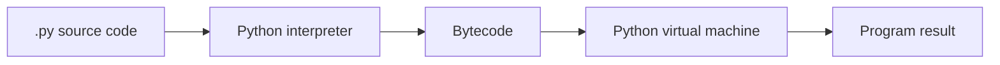
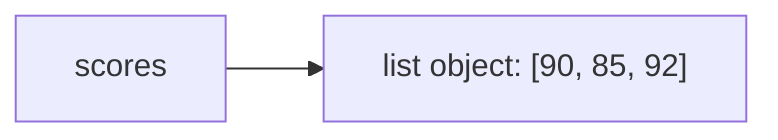
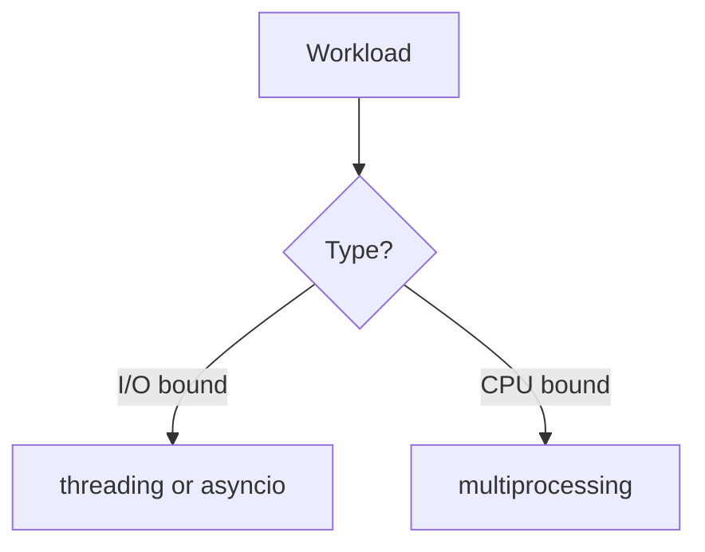

# 01. Python Core And Advanced Concepts

## 1. What Python Is

Python is a high-level programming language used for APIs, automation, data science, machine learning, scripting, testing, and backend systems.

Python is popular because:

- Syntax is readable.
- Standard library is large.
- Data and ML ecosystem is strong.
- Web frameworks like FastAPI are productive.
- It works well for both scripts and production systems.

## 2. Execution Mental Model

Python code is read by the Python interpreter.



When you run:

```bash
python app.py
```

Python starts the interpreter, loads `app.py`, executes top-level code, imports modules, and exits when work is done.

## 3. Variables And Objects

In Python, variables are names pointing to objects.

```python
name = "Asha"
age = 21
scores = [90, 85, 92]
```

Mental model:



Assignment does not always copy data:

```python
a = [1, 2, 3]
b = a
b.append(4)
print(a)
```

Output:

```txt
[1, 2, 3, 4]
```

`a` and `b` point to the same list.

## 4. Mutable Vs Immutable

Immutable:

- `int`
- `float`
- `str`
- `tuple`
- `frozenset`

Mutable:

- `list`
- `dict`
- `set`
- most class instances

Example:

```python
text = "hello"
upper_text = text.upper()
print(text)
print(upper_text)
```

Strings do not change in place. A new string is created.

## 5. Functions

```python
def calculate_total(price: float, quantity: int) -> float:
    return price * quantity

total = calculate_total(99.5, 3)
print(total)
```

Line by line:

- `def` creates a function.
- `price` and `quantity` are parameters.
- Type hints describe expected values.
- `return` sends a result back.
- `calculate_total(...)` calls the function.

## 6. Default Arguments

```python
def greet(name: str, greeting: str = "Hello") -> str:
    return f"{greeting}, {name}"
```

Avoid mutable defaults:

```python
def add_item(item: str, items: list[str] = []) -> list[str]:
    items.append(item)
    return items
```

Better:

```python
def add_item(item: str, items: list[str] | None = None) -> list[str]:
    if items is None:
        items = []
    items.append(item)
    return items
```

## 7. Comprehensions In Depth

Comprehensions create collections from iterables in a concise way.

Basic list comprehension:

```python
squares = [number * number for number in range(5)]
print(squares)
```

Equivalent loop:

```python
squares = []
for number in range(5):
    squares.append(number * number)
```

Structure:

```txt
[expression for item in iterable if condition]
```

Filter:

```python
even_numbers = [n for n in range(20) if n % 2 == 0]
```

Transform:

```python
names = [" asha ", "RAVI", "Meera"]
clean_names = [name.strip().title() for name in names]
```

Nested loops:

```python
pairs = [(x, y) for x in [1, 2, 3] for y in ["a", "b"]]
```

Read it in the same order as loops:

```python
pairs = []
for x in [1, 2, 3]:
    for y in ["a", "b"]:
        pairs.append((x, y))
```

Nested list comprehension:

```python
matrix = [
    [1, 2, 3],
    [4, 5, 6],
]

flattened = [value for row in matrix for value in row]
```

Dictionary comprehension:

```python
word_lengths = {word: len(word) for word in ["python", "api", "data"]}
```

Set comprehension:

```python
unique_first_letters = {word[0] for word in ["apple", "api", "banana"]}
```

Generator expression:

```python
total = sum(number * number for number in range(1_000_000))
```

Generator expressions do not build a full list in memory.

When not to use comprehensions:

- Logic has many branches.
- You need multiple side effects.
- Readability becomes poor.

## 8. Collections Module

`collections` provides specialized containers.

### Counter

```python
from collections import Counter

words = ["api", "python", "api", "data"]
counts = Counter(words)
print(counts["api"])
```

Use for frequency counting.

### defaultdict

```python
from collections import defaultdict

groups: dict[str, list[str]] = defaultdict(list)
groups["backend"].append("FastAPI")
groups["backend"].append("Postgres")
```

Avoids manual key existence checks.

### deque

```python
from collections import deque

queue = deque()
queue.append("first")
queue.append("second")
print(queue.popleft())
```

Efficient queue operations from both ends.

### namedtuple

```python
from collections import namedtuple

Point = namedtuple("Point", ["x", "y"])
p = Point(2, 3)
print(p.x)
```

For modern code, `dataclass` is often more flexible.

## 9. Dataclasses

```python
from dataclasses import dataclass

@dataclass
class Product:
    id: int
    name: str
    price: float

product = Product(id=1, name="Keyboard", price=1500.0)
```

Dataclasses reduce boilerplate for plain data objects.

## 10. Iterators And Iterables

Iterable:

- Something you can loop over.

Iterator:

- Object that returns the next item with `next()`.

```python
numbers = iter([1, 2, 3])
print(next(numbers))
print(next(numbers))
```

## 11. itertools

`itertools` helps build efficient iterator pipelines.

```python
import itertools

for pair in itertools.product(["S", "M"], ["red", "blue"]):
    print(pair)
```

Useful tools:

- `count`: infinite counter.
- `cycle`: repeat values forever.
- `repeat`: repeat one value.
- `chain`: combine iterables.
- `islice`: slice an iterator.
- `groupby`: group consecutive items.
- `product`: Cartesian product.
- `permutations`: ordered arrangements.
- `combinations`: unordered selections.

Example:

```python
from itertools import chain

all_items = chain(["a", "b"], ["c", "d"])
print(list(all_items))
```

## 12. functools

`functools` provides higher-order function utilities.

### lru_cache

```python
from functools import lru_cache

@lru_cache(maxsize=128)
def fib(n: int) -> int:
    if n <= 1:
        return n
    return fib(n - 1) + fib(n - 2)
```

This caches previous results.

### partial

```python
from functools import partial

def power(base: int, exponent: int) -> int:
    return base**exponent

square = partial(power, exponent=2)
print(square(5))
```

### reduce

```python
from functools import reduce

numbers = [1, 2, 3, 4]
total = reduce(lambda a, b: a + b, numbers)
```

Prefer `sum`, `any`, `all`, and clear loops when they read better.

## 13. Decorators

A decorator wraps a function.

```python
from functools import wraps
from time import perf_counter

def time_it(func):
    @wraps(func)
    def wrapper(*args, **kwargs):
        start = perf_counter()
        result = func(*args, **kwargs)
        end = perf_counter()
        print(f"{func.__name__} took {end - start:.4f}s")
        return result

    return wrapper

@time_it
def slow_add(a, b):
    return a + b
```

Line by line:

- `time_it` receives a function.
- `wrapper` accepts any arguments.
- It records time before and after.
- It calls the original function.
- It returns the original result.
- `@time_it` replaces `slow_add` with the wrapped version.

## 14. Context Managers

Context managers handle setup and cleanup.

```python
with open("data.txt", "w", encoding="utf-8") as file:
    file.write("hello")
```

The file is closed automatically.

Custom context manager:

```python
from contextlib import contextmanager

@contextmanager
def managed_resource():
    print("setup")
    try:
        yield "resource"
    finally:
        print("cleanup")
```

## 15. Exceptions

```python
try:
    number = int("abc")
except ValueError as error:
    print(f"Could not parse number: {error}")
else:
    print(number)
finally:
    print("done")
```

Use custom exceptions for domain-specific failures:

```python
class InsufficientBalanceError(Exception):
    pass
```

## 16. Concurrency Overview

Concurrency means handling multiple tasks during the same time period.

Parallelism means actually executing multiple tasks at the same instant.



I/O bound:

- Waiting for network.
- Waiting for database.
- Waiting for files.

CPU bound:

- Heavy math.
- Image processing.
- Model training.

## 17. Threading

Threads share memory inside one process.

```python
from concurrent.futures import ThreadPoolExecutor
import requests

urls = [
    "https://example.com",
    "https://python.org",
]

def fetch(url: str) -> int:
    response = requests.get(url, timeout=10)
    return response.status_code

with ThreadPoolExecutor(max_workers=5) as executor:
    results = list(executor.map(fetch, urls))
```

Good for I/O-bound tasks.

## 18. Multiprocessing

Processes have separate memory and can use multiple CPU cores.

```python
from concurrent.futures import ProcessPoolExecutor

def square(number: int) -> int:
    return number * number

with ProcessPoolExecutor() as executor:
    results = list(executor.map(square, range(10)))
```

Good for CPU-bound tasks.

## 19. asyncio

`asyncio` is cooperative concurrency using an event loop.

```python
import asyncio

async def say_after(delay: float, message: str) -> None:
    await asyncio.sleep(delay)
    print(message)

async def main() -> None:
    await asyncio.gather(
        say_after(1, "hello"),
        say_after(1, "world"),
    )

asyncio.run(main())
```

Line by line:

- `async def` defines a coroutine.
- `await` pauses this coroutine while other work can run.
- `gather` runs coroutines concurrently.
- `asyncio.run` starts the event loop.

## 20. GIL

CPython has a Global Interpreter Lock for many builds and versions. It limits how multiple threads execute Python bytecode at once. This is why threads are usually best for I/O and processes are better for CPU-heavy Python code.

## 21. Profiling

Profiling finds where time or memory is spent.

Basic timing:

```python
from time import perf_counter

start = perf_counter()
result = sum(range(10_000_000))
end = perf_counter()
print(end - start)
```

cProfile:

```bash
python -m cProfile -s cumulative app.py
```

Line profiler and memory profiler can be added for deeper analysis.

Optimization order:

1. Measure first.
2. Find bottleneck.
3. Improve algorithm.
4. Use vectorization or compiled libraries.
5. Cache when correct.
6. Parallelize only when needed.

