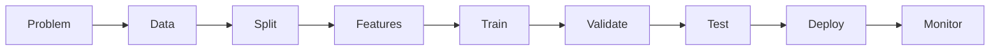
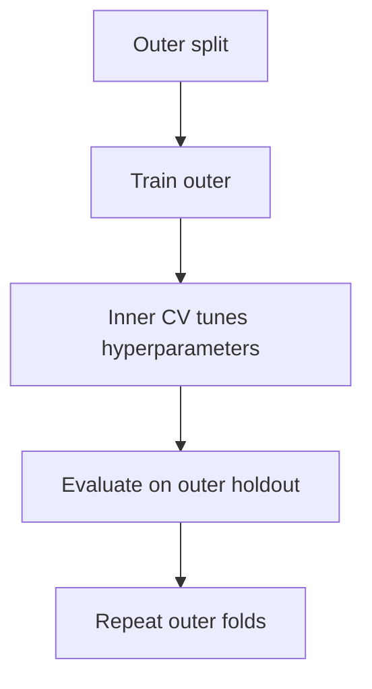

# 06. Classical Machine Learning And Evaluation

## 1. What Machine Learning Is

Machine learning builds systems that learn patterns from data to make predictions or decisions.

Supervised learning:

- Data has target labels.
- Examples: predict price, classify churn.

Unsupervised learning:

- No target labels.
- Examples: clustering, dimensionality reduction.

Reinforcement learning:

- Agent learns through rewards.

## 2. ML Workflow



Do not start with algorithms. Start with the business problem and metric.

## 3. Train, Validation, Test

Train set:

- Used to fit model.

Validation set:

- Used to choose model and hyperparameters.

Test set:

- Used once for final unbiased evaluation.

If you tune repeatedly on the test set, it becomes another validation set.

## 4. Bias-Variance Intuition

Error can come from:

- Bias: model too simple, misses true pattern.
- Variance: model too sensitive to training data.
- Irreducible noise: randomness no model can remove.

```txt
Expected prediction error = bias^2 + variance + noise
```

## 5. Bias-Variance Derivation Sketch

Let target be:

```txt
y = f(x) + epsilon
```

where `epsilon` has mean `0` and variance `sigma^2`.

For a model prediction `h(x)`, expected squared error:

```txt
E[(y - h(x))^2]
```

Substitute:

```txt
E[(f(x) + epsilon - h(x))^2]
```

After expanding and using `E[epsilon] = 0`, error decomposes into:

```txt
(Bias of h)^2 + Variance of h + sigma^2
```

Practical meaning:

- Simple linear model may have high bias.
- Deep tree may have high variance.
- Regularization often reduces variance.

## 6. Linear Regression

Model:

```txt
y = beta_0 + beta_1 x_1 + ... + beta_p x_p + error
```

scikit-learn:

```python
from sklearn.linear_model import LinearRegression
from sklearn.metrics import mean_absolute_error
from sklearn.model_selection import train_test_split

X_train, X_test, y_train, y_test = train_test_split(X, y, test_size=0.2, random_state=42)

model = LinearRegression()
model.fit(X_train, y_train)
predictions = model.predict(X_test)

mae = mean_absolute_error(y_test, predictions)
```

## 7. Linear Model Assumptions

Common assumptions for inference:

- Linearity.
- Independent errors.
- Constant error variance.
- Normally distributed residuals for certain tests.
- No severe multicollinearity.
- No major influential outliers.

Diagnostics:

- Residuals vs fitted plot.
- Q-Q plot.
- Variance inflation factor.
- Leverage and Cook's distance.

## 8. Logistic Regression

Logistic regression predicts probability for binary classification.

```python
from sklearn.linear_model import LogisticRegression

model = LogisticRegression(max_iter=1000)
model.fit(X_train, y_train)
probabilities = model.predict_proba(X_test)[:, 1]
```

Output is probability-like, but calibration must be checked.

## 9. Regularization

Ridge:

- L2 penalty.
- Shrinks coefficients.

Lasso:

- L1 penalty.
- Can set coefficients to zero.

Elastic Net:

- Mix of L1 and L2.

```python
from sklearn.linear_model import Ridge

model = Ridge(alpha=1.0)
```

`alpha` controls regularization strength.

## 10. Classification Metrics

Confusion matrix:

```txt
              Predicted Positive   Predicted Negative
Actual Positive       TP                  FN
Actual Negative       FP                  TN
```

Metrics:

```txt
accuracy = (TP + TN) / total
precision = TP / (TP + FP)
recall = TP / (TP + FN)
F1 = 2 * precision * recall / (precision + recall)
```

## 11. ROC-AUC Vs PR-AUC

ROC-AUC:

- Measures ranking across true positive rate and false positive rate.
- Can look strong on imbalanced data.

PR-AUC:

- Precision-recall curve area.
- More informative when positive class is rare.

Rule:

- Balanced classes: ROC-AUC can be fine.
- Rare positives: PR-AUC is usually more useful.

## 12. Calibration

Calibration asks whether predicted probabilities match real frequencies.

If model says 0.8 probability for 1000 users, about 800 should be positive.

```python
from sklearn.calibration import CalibratedClassifierCV

calibrated = CalibratedClassifierCV(model, method="isotonic", cv=5)
calibrated.fit(X_train, y_train)
```

Calibration methods:

- Platt scaling.
- Isotonic regression.

## 13. Cross-Validation

```python
from sklearn.model_selection import cross_val_score

scores = cross_val_score(model, X, y, cv=5, scoring="roc_auc")
```

Cross-validation estimates model performance more reliably than one split.

## 14. Nested Cross-Validation

Nested CV separates hyperparameter tuning from final evaluation.



Use nested CV when you need a less biased estimate of tuned model performance.

## 15. Pipelines

Pipelines prevent leakage and keep preprocessing tied to training.

```python
from sklearn.compose import ColumnTransformer
from sklearn.impute import SimpleImputer
from sklearn.pipeline import Pipeline
from sklearn.preprocessing import OneHotEncoder, StandardScaler
from sklearn.linear_model import LogisticRegression

numeric_features = ["age", "income"]
categorical_features = ["country", "plan"]

preprocess = ColumnTransformer(
    transformers=[
        ("num", Pipeline([("imputer", SimpleImputer()), ("scaler", StandardScaler())]), numeric_features),
        ("cat", OneHotEncoder(handle_unknown="ignore"), categorical_features),
    ]
)

model = Pipeline(
    steps=[
        ("preprocess", preprocess),
        ("classifier", LogisticRegression(max_iter=1000)),
    ]
)
```

Fit the full pipeline only on training data.

## 16. Feature Leakage

Leakage happens when training data contains information that would not be available at prediction time.

Case studies:

- Churn model uses `account_closed_date`.
- Fraud model uses manual review outcome.
- Loan default model uses payment after approval.
- Time-series model uses future rolling average.
- Preprocessing scaler fit on full dataset before split.

Prevention:

- Define prediction time.
- Split before preprocessing.
- Use pipelines.
- For time data, split by time.
- Review each feature with domain experts.

## 17. Tree Models

Decision trees:

- Easy to interpret.
- Can overfit.

Random forest:

- Many trees trained on bootstrapped data.
- Reduces variance.

Gradient boosting:

- Trees trained sequentially to fix errors.
- Often high performance on tabular data.

## 18. Hyperparameter Search

```python
from sklearn.model_selection import RandomizedSearchCV

param_grid = {
    "classifier__C": [0.01, 0.1, 1, 10],
}

search = RandomizedSearchCV(
    model,
    param_distributions=param_grid,
    n_iter=4,
    cv=5,
    scoring="roc_auc",
    random_state=42,
)
search.fit(X_train, y_train)
```

## 19. Model Interpretation

Approaches:

- Coefficients for linear models.
- Feature importance for tree models.
- Permutation importance.
- Partial dependence plots.
- SHAP values.

Be careful: importance does not always mean causality.

## 20. Regression Metrics

MAE:

- Average absolute error.
- Easy to understand.

MSE/RMSE:

- Penalizes large errors more.

R-squared:

- Fraction of variance explained.
- Can be misleading alone.

MAPE:

- Percentage error.
- Problems when true values near zero.

## 21. Classification Thresholds

Models often output probabilities. A threshold turns probability into class.

```python
threshold = 0.35
predicted_class = (probabilities >= threshold).astype(int)
```

Choose threshold based on cost:

- False positives expensive?
- False negatives expensive?
- Need high recall?
- Need high precision?

