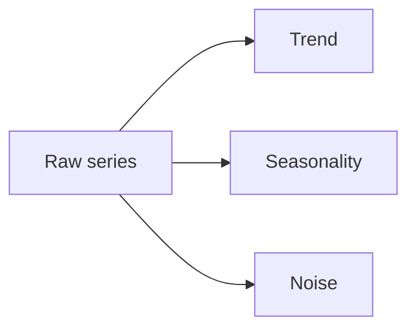

# 07. Advanced ML Topics

## 1. Gradient Boosting Libraries

For tabular data, gradient boosting models are often strong baselines.

Popular libraries:

- XGBoost.
- LightGBM.
- CatBoost.

They build many weak decision trees sequentially. Each new tree tries to correct mistakes from previous trees.

## 2. XGBoost

```python
from xgboost import XGBClassifier

model = XGBClassifier(
    n_estimators=300,
    learning_rate=0.05,
    max_depth=4,
    subsample=0.8,
    colsample_bytree=0.8,
    eval_metric="logloss",
)

model.fit(X_train, y_train)
```

Key hyperparameters:

- `n_estimators`: number of trees.
- `learning_rate`: contribution of each tree.
- `max_depth`: tree complexity.
- `subsample`: row sampling.
- `colsample_bytree`: feature sampling.
- `reg_alpha`, `reg_lambda`: regularization.

## 3. LightGBM

LightGBM is fast and memory efficient.

```python
from lightgbm import LGBMClassifier

model = LGBMClassifier(
    n_estimators=500,
    learning_rate=0.03,
    num_leaves=31,
)
model.fit(X_train, y_train)
```

Good for:

- Large tabular datasets.
- Many features.
- Fast experiments.

Watch out:

- Can overfit.
- Categorical handling requires care.
- Validate properly.

## 4. CatBoost

CatBoost handles categorical features well.

```python
from catboost import CatBoostClassifier

model = CatBoostClassifier(
    iterations=500,
    learning_rate=0.05,
    depth=6,
    verbose=False,
)
model.fit(X_train, y_train, cat_features=["country", "plan"])
```

Good when you have many categorical variables.

## 5. Anomaly Detection

Anomaly detection finds unusual observations.

Use cases:

- Fraud.
- System failures.
- Network intrusion.
- Sensor defects.
- Data quality issues.

Methods:

- Rule-based thresholds.
- Z-score.
- Isolation Forest.
- One-Class SVM.
- Local Outlier Factor.
- Autoencoders.

Isolation Forest:

```python
from sklearn.ensemble import IsolationForest

model = IsolationForest(contamination=0.01, random_state=42)
labels = model.fit_predict(X)
```

`-1` usually means anomaly and `1` means normal.

## 6. PCA

Principal Component Analysis reduces dimensionality by finding directions of maximum variance.

```python
from sklearn.decomposition import PCA
from sklearn.preprocessing import StandardScaler

scaled = StandardScaler().fit_transform(X)
pca = PCA(n_components=2)
components = pca.fit_transform(scaled)
```

Use PCA for:

- Visualization.
- Noise reduction.
- Compression.
- Handling correlated features.

Remember: PCA components are linear combinations and may be hard to interpret.

## 7. UMAP

UMAP is a nonlinear dimensionality reduction method often used for visualization.

```python
import umap

reducer = umap.UMAP(n_components=2, random_state=42)
embedding = reducer.fit_transform(X)
```

Use for:

- Exploring clusters.
- Visualizing high-dimensional embeddings.

Do not overinterpret distances unless you understand the settings.

## 8. Time-Series Forecasting

Time series data is ordered by time.

Common components:

- Trend.
- Seasonality.
- Cycles.
- Noise.
- Holidays/events.



## 9. Forecasting Validation

Do not shuffle time-series data.

Use time-based splits:

```txt
Train: Jan-Mar -> Validate: Apr
Train: Jan-Apr -> Validate: May
Train: Jan-May -> Validate: Jun
```

This is rolling or expanding window validation.

## 10. Forecasting Features

```python
df["day_of_week"] = df.index.dayofweek
df["month"] = df.index.month
df["lag_1"] = df["sales"].shift(1)
df["lag_7"] = df["sales"].shift(7)
df["rolling_7"] = df["sales"].shift(1).rolling(7).mean()
```

Important: use `shift(1)` before rolling to avoid using today's target to predict today.

## 11. Forecasting Models

Classical:

- Naive forecast.
- Moving average.
- Exponential smoothing.
- ARIMA/SARIMA.

ML:

- Linear regression with lag features.
- Random forest.
- Gradient boosting.
- Neural networks.

Always compare against a simple baseline.

## 12. Recommender Systems

Recommendation types:

- Popularity-based.
- Content-based.
- Collaborative filtering.
- Matrix factorization.
- Learning-to-rank.
- Hybrid recommenders.

User-item matrix:

```txt
          Item A  Item B  Item C
User 1      5      ?       2
User 2      ?      4       1
User 3      3      5       ?
```

## 13. Content-Based Recommendation

Recommend similar items based on item features.

```python
from sklearn.feature_extraction.text import TfidfVectorizer
from sklearn.metrics.pairwise import cosine_similarity

tfidf = TfidfVectorizer(stop_words="english")
item_vectors = tfidf.fit_transform(items["description"])
similarity = cosine_similarity(item_vectors)
```

## 14. Collaborative Filtering

Collaborative filtering learns from user-item interactions.

Implicit feedback examples:

- Clicks.
- Views.
- Purchases.
- Watch time.

Explicit feedback:

- Ratings.
- Likes.

Evaluation is tricky because missing does not always mean dislike.

## 15. Survival Analysis

Survival analysis models time until event.

Examples:

- Time until churn.
- Time until machine failure.
- Time until loan default.
- Time until recovery.

Key concepts:

- Event: thing being modeled.
- Duration: time observed.
- Censoring: event not observed before observation ends.

## 16. Censoring

If a customer has not churned yet, we do not know their final churn time. We only know they survived at least until now. That is right-censoring.

Survival analysis handles censored data better than simply dropping those rows.

## 17. Kaplan-Meier Curve

Kaplan-Meier estimates survival probability over time.

```python
from lifelines import KaplanMeierFitter

kmf = KaplanMeierFitter()
kmf.fit(durations=df["days_active"], event_observed=df["churned"])
kmf.plot_survival_function()
```

## 18. Cox Proportional Hazards

```python
from lifelines import CoxPHFitter

cph = CoxPHFitter()
cph.fit(df, duration_col="days_active", event_col="churned")
cph.print_summary()
```

Hazard ratio:

- Greater than 1: higher event risk.
- Less than 1: lower event risk.

## 19. ML For APIs

Serving model predictions through FastAPI:

```python
import joblib
from fastapi import FastAPI
from pydantic import BaseModel

class PredictionRequest(BaseModel):
    age: int
    income: float

class PredictionResponse(BaseModel):
    probability: float

app = FastAPI()
model = joblib.load("model.joblib")

@app.post("/predict", response_model=PredictionResponse)
def predict(request: PredictionRequest):
    features = [[request.age, request.income]]
    probability = model.predict_proba(features)[0, 1]
    return PredictionResponse(probability=probability)
```

Production considerations:

- Validate inputs.
- Version model.
- Log request metadata, not secrets.
- Monitor latency and errors.
- Monitor feature drift and prediction drift.

## 20. Model Monitoring

Monitor:

- Input schema validity.
- Missing values.
- Feature distributions.
- Prediction distributions.
- Latency.
- Error rates.
- Business outcomes.
- Ground-truth performance when labels arrive.

Drift types:

- Feature drift: input data changes.
- Prediction drift: model outputs change.
- Concept drift: relationship between features and target changes.

## 21. Responsible ML

Ask:

- Who can be harmed by wrong predictions?
- Are protected groups affected differently?
- Is training data representative?
- Are explanations needed?
- Is human review required?
- Can users appeal decisions?

Technical quality is not enough. ML systems affect people and operations.

