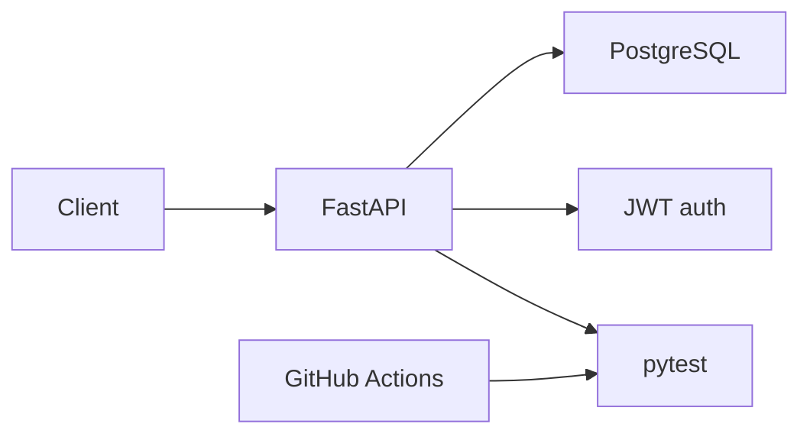
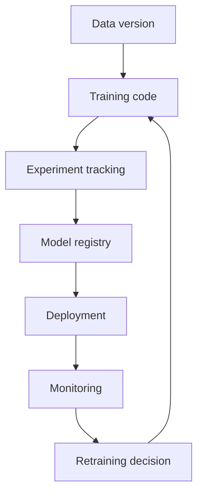

# 08. Projects, MLOps, Roadmap, And Sources

## 1. Full Learning Roadmap

Stage 1: Python foundations.

- Functions.
- Data structures.
- Comprehensions.
- Modules.
- Errors.
- Testing.

Stage 2: Professional Python.

- Virtual environments.
- pyproject.toml.
- Ruff/Black.
- mypy.
- pytest.
- Logging.
- Profiling.

Stage 3: Backend APIs.

- FastAPI.
- Pydantic.
- CRUD.
- SQL.
- PostgreSQL.
- SQLAlchemy.
- Alembic.
- Auth.
- Testing.
- Docker.
- CI/CD.

Stage 4: Data analysis.

- pandas.
- SQL analytics.
- Visualization.
- Probability.
- Inference.
- A/B testing.

Stage 5: Machine learning.

- Supervised learning.
- Metrics.
- Cross-validation.
- Leakage.
- Linear models.
- Tree models.
- Gradient boosting.

Stage 6: Advanced ML and production.

- Forecasting.
- Recommenders.
- Survival analysis.
- Model serving.
- MLOps.
- Monitoring.

## 2. Project 1: FastAPI Social Posts API

Features:

- User registration.
- Login.
- JWT authentication.
- Create/read/update/delete posts.
- Users can only modify their own posts.
- Vote/like posts.
- Query params for pagination and search.
- PostgreSQL database.
- SQLAlchemy ORM.
- Alembic migrations.
- pytest tests.
- Docker Compose.
- GitHub Actions.

Architecture:



## 3. Project 2: Analytics Dashboard

Goal:

- Load sales data.
- Clean missing values.
- Run SQL aggregations.
- Create pandas summaries.
- Make charts with clear story.
- Export report.

Core questions:

- What is revenue trend?
- Which products drive growth?
- Which segments are declining?
- Are outliers real?

## 4. Project 3: A/B Testing Notebook

Goal:

- Simulate or load experiment data.
- Validate randomization.
- Check sample ratio mismatch.
- Estimate conversion rates.
- Run hypothesis test.
- Calculate confidence interval.
- Report effect size and recommendation.

Decision template:

```txt
Treatment changed conversion by X percentage points.
The confidence interval is [low, high].
Guardrail metrics did/did not degrade.
Recommendation: ship, do not ship, or continue experiment.
```

## 5. Project 4: Churn Prediction API

Training:

- Load customer data.
- Split by time.
- Build preprocessing pipeline.
- Train logistic regression and gradient boosting.
- Compare ROC-AUC and PR-AUC.
- Calibrate probabilities.
- Save model.

Serving:

- FastAPI `/predict` endpoint.
- Pydantic request schema.
- Model version in response.
- Docker deployment.

## 6. Project 5: Forecasting System

Goal:

- Forecast daily demand.
- Use time-based validation.
- Create lag and rolling features.
- Compare naive baseline vs ML model.
- Monitor forecast error.

Critical rule:

- Never use future values to create features for the past.

## 7. MLOps Mental Model

MLOps is software engineering plus data engineering plus ML operations.



## 8. Model Versioning

Version:

- Code.
- Data.
- Features.
- Hyperparameters.
- Metrics.
- Model artifact.
- Environment.

Artifact example:

```txt
models/
  churn_model/
    2026-07-09-v1/
      model.joblib
      metrics.json
      schema.json
      training_config.yaml
```

## 9. Experiment Tracking

Track:

- Dataset version.
- Train/validation split.
- Model type.
- Hyperparameters.
- Metrics.
- Confusion matrix.
- Feature importance.
- Notes.

Tools:

- MLflow.
- Weights and Biases.
- Neptune.
- Vertex AI/AWS SageMaker registries.
- Simple files for small projects.

## 10. Model Registry

A model registry stores approved model versions and stages.

Stages:

- Experimental.
- Staging.
- Production.
- Archived.

Promotion rule:

- Promote only if tests pass, metrics improve or meet threshold, and risk is reviewed.

## 11. Feature Store Idea

A feature store manages features for training and serving.

Problem it solves:

- Training uses one feature definition.
- Production uses a different feature definition.
- Model performs badly because features are inconsistent.

Feature store goal:

- Same feature logic for offline training and online serving.

## 12. ML Deployment Patterns

Batch prediction:

- Run predictions on schedule.
- Store results in database or file.

Online prediction:

- API returns prediction in real time.

Streaming prediction:

- Process events continuously.

Shadow deployment:

- New model receives traffic but does not affect user decision.

Canary:

- Small percentage of traffic uses new model first.

## 13. Monitoring Checklist

API monitoring:

- Request rate.
- Latency.
- Error rate.
- CPU/memory.
- Dependency failures.

ML monitoring:

- Input schema violations.
- Missing feature rate.
- Feature drift.
- Prediction drift.
- Calibration drift.
- Performance after labels arrive.

Business monitoring:

- Revenue.
- Churn.
- Fraud caught.
- False-positive cost.
- User complaints.

## 14. Production ML API Checklist

Before deployment:

1. Model artifact versioned.
2. Training data version recorded.
3. Preprocessing included in pipeline.
4. Input schema validated.
5. Tests cover prediction endpoint.
6. Latency measured.
7. Fallback behavior defined.
8. Monitoring configured.
9. Rollback plan ready.
10. Bias/fairness risks reviewed.

## 15. Python/FastAPI Command Cheat Sheet

Create venv:

```bash
python -m venv .venv
```

Install:

```bash
python -m pip install "fastapi[standard]" sqlalchemy alembic pytest
```

Run app:

```bash
fastapi dev app/main.py
```

Run migrations:

```bash
alembic revision --autogenerate -m "message"
alembic upgrade head
```

Test:

```bash
pytest -v
```

Quality:

```bash
ruff check . --fix
ruff format .
mypy app
```

Docker:

```bash
docker compose up --build
```

## 16. Official Sources Used

These notes were grounded against current official documentation checked on 2026-07-09:

- Python data structures and comprehensions: https://docs.python.org/3/tutorial/datastructures.html
- Python packaging and pyproject.toml: https://packaging.python.org/en/latest/guides/writing-pyproject-toml/
- Ruff documentation: https://docs.astral.sh/ruff/
- Black documentation: https://black.readthedocs.io/en/stable/
- FastAPI documentation: https://fastapi.tiangolo.com/
- Pydantic documentation: https://docs.pydantic.dev/latest/
- SQLAlchemy ORM documentation: https://docs.sqlalchemy.org/en/20/orm/quickstart.html
- Alembic tutorial: https://alembic.sqlalchemy.org/en/latest/tutorial.html
- pandas user guide: https://pandas.pydata.org/docs/user_guide/index.html
- scikit-learn user guide: https://scikit-learn.org/stable/user_guide.html
- pytest documentation: https://docs.pytest.org/en/stable/
- mypy documentation: https://mypy.readthedocs.io/en/stable/

## 17. Final Advice

For this whole path, build in this order:

1. Python scripts.
2. Tested Python package.
3. FastAPI CRUD API.
4. FastAPI API with Postgres and auth.
5. Dockerized deployment.
6. CI/CD pipeline.
7. pandas analytics report.
8. A/B test analysis.
9. ML training pipeline.
10. ML prediction API.
11. Monitored production-style ML service.

The goal is not only to know concepts. The goal is to connect them into systems that are tested, explainable, deployable, and maintainable.

