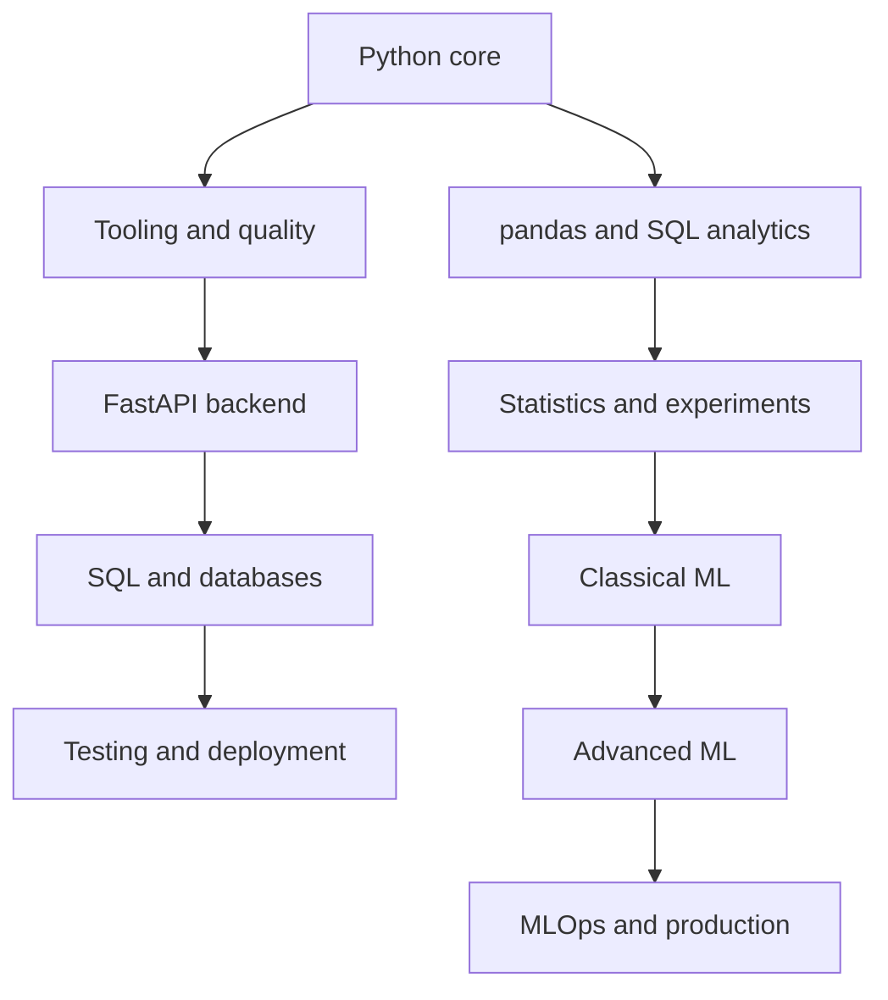

# Complete Python, FastAPI, Data Science, ML, And MLOps Notes

This bundle is a beginner-to-advanced learning path for the topics you listed:

- Python deep concepts.
- Modern Python project tooling.
- FastAPI backend development.
- PostgreSQL, SQL, SQLAlchemy, Alembic.
- Authentication, JWT, OAuth2, CORS.
- Testing, Docker, CI/CD, and deployment.
- Data analysis with pandas and SQL.
- Probability, statistics, inference, A/B testing.
- Classical machine learning and model evaluation.
- Time series, recommender systems, survival analysis.
- MLOps, model versioning, profiling, and production readiness.

## Files

- [01-python-core-advanced.md](./01-python-core-advanced.md): Python from strong foundations to comprehensions, collections, itertools, functools, concurrency, profiling.
- [02-tooling-packaging-quality.md](./02-tooling-packaging-quality.md): virtual environments, pip, pyproject.toml, Ruff, Black, mypy, pytest, project layout.
- [03-fastapi-postgres-sqlalchemy.md](./03-fastapi-postgres-sqlalchemy.md): FastAPI, HTTP, Pydantic, CRUD, SQL, Postgres, SQLAlchemy, Alembic.
- [04-auth-testing-deployment-cicd.md](./04-auth-testing-deployment-cicd.md): users, password hashing, JWT, routers, CORS, Docker, NGINX, systemd, GitHub Actions.
- [05-data-pandas-sql-viz-statistics.md](./05-data-pandas-sql-viz-statistics.md): advanced pandas, SQL, visualization storytelling, probability, inference, hypothesis tests, A/B testing.
- [06-classical-ml-evaluation.md](./06-classical-ml-evaluation.md): ML workflow, bias-variance, linear models, diagnostics, metrics, calibration, CV, leakage.
- [07-advanced-ml-topics.md](./07-advanced-ml-topics.md): XGBoost, LightGBM, CatBoost, anomaly detection, PCA, UMAP, forecasting, recommenders, survival analysis.
- [08-projects-mlops-roadmap-sources.md](./08-projects-mlops-roadmap-sources.md): projects, MLOps, versioning, deployment patterns, checklists, sources.

## Big Picture

## Study Method

1. Read one chapter.
2. Type the code.
3. Run it.
4. Break it intentionally.
5. Debug it.
6. Explain the concept in simple words.
7. Build the project connected to that chapter.

Do not try to memorize every library function. Learn the mental model first, then practice with real projects.

